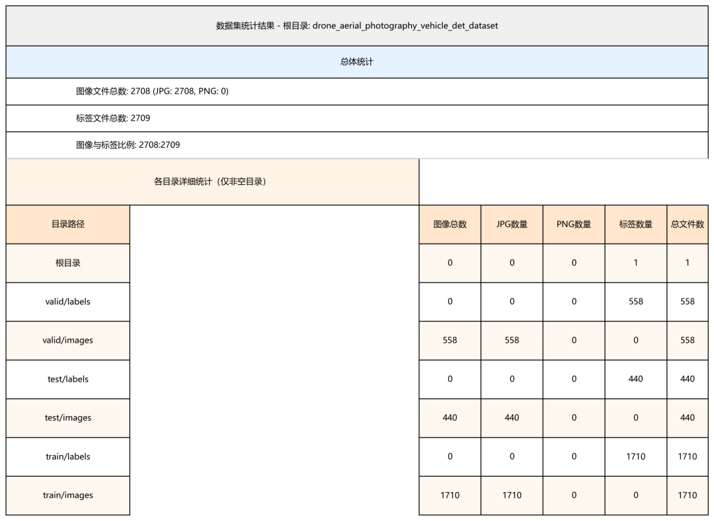
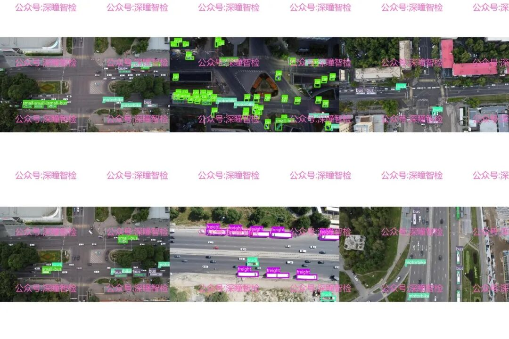
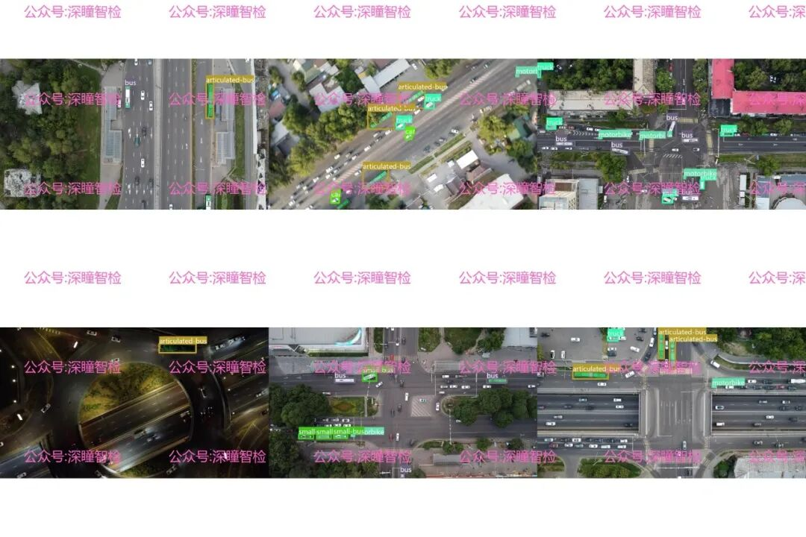

# Target Detection Dataset - Volume 118 - Drone Aerial Vehicle Recognition Detection Dataset Based on the Yolo Annotation Format

#### 1. Background

In the urban traffic management system, precise grasp of the distribution and flow of road vehicles is the core premise to optimize the efficiency of passage and relieve congestion. Traditional ground monitoring equipment has limited coverage and is easily obstructed, which makes it difficult to achieve large-scale, dynamic traffic situation perception.

With the maturity of drone technology, its aerial perspective and flexible deployment capabilities have become an important supplementary means for urban traffic monitoring. Vehicle recognition algorithms based on computer vision can extract traffic data from drone aerial images, but the performance of such algorithms highly depends on high-quality labeled datasets. The **Drone Aerial Vehicle Recognition Detection Dataset** introduced in this session is precisely constructed to meet this technical demand, aiming to provide training samples that closely resemble real urban traffic scenarios for algorithm research and development.

The dataset covers typical urban traffic environments: it includes light changes at different times such as daytime, twilight, and nighttime, as well as complex scenes like intersections and main roads. It simulates the real-world visual challenges observed from an aerial perspective, helping algorithms better cope with interference factors in reality and enhance the robustness of detection.

#### 2. Data details

##### 2.1 Overall Scale

This dataset consists of **2708 image files** in JPG format, with no PNG files included. The total number of annotation files is **2709**, and the ratio of images to annotation files is close to 1:1, ensuring a high degree of data match with the annotations. All annotation files are in YOLO format as TXT files, each corresponding to an image, recording the bounding box coordinates and category information for the vehicle area. The categories include "PMT," "articulated-bus," "bus," "car," "freight," "motorbike," "small-bus," and "truck" across 8 classes.

##### 2.2 Subset partitioning

Dataset is divided into three subsets according to the needs of algorithm training and evaluation:

-

• **Training Set**: Containing 1710 images and 1710 annotation files, totaling 3420 files, which is the core data source for model training, providing the algorithm with a large number of basic samples to learn vehicle feature patterns.

-

• **Validation set**: contains 558 images and 558 annotation files, totaling 1116 files, used to evaluate the model's generalization ability during training, help researchers adjust algorithm parameters to avoid overfitting.

-

• **Test Set**: Contains 440 images and 440 annotation files, totaling 880 files. It is used to evaluate the final performance after the model training is completed, verifying the recognition accuracy of the algorithm on unseen samples.

##### 2.3 Storage Structure

The dataset is organized in a clear hierarchical directory structure, facilitating easy access and management during algorithm development.

-

• The root directory contains only one statistical file, which records the overall overview of the dataset.

-

- `train/images`, `valid/images`, `test/images` directories store the image files of the training set, validation set and test set respectively.

-

• `train/labels`, `valid/labels`, and `test/labels` directories correspond to the YOLO format annotation files for storing training set, validation set, and test set labels respectively.

This structure conforms to the mainstream computer vision dataset specifications, can seamlessly integrate with training frameworks of mainstream detection algorithms such as YOLO series, and reduces the cost of algorithm development adaptation.

##### 2.4 Data Characteristics

From the sample images, it is evident that the dataset covers a wide range of urban traffic scenarios: different vehicle types, varying densities of traffic flow, and natural shadows, vehicle obstruction, and complex backgrounds in the city environment. This simulates the visual conditions encountered in real-world high-altitude monitoring. The 8 classes of vehicles labeled cover common vehicle types on urban roads, including large vehicles such as "hinged bus" and "freight truck," which provide accurate supervision information for model learning the visual features of different scale vehicles.

#### 3. Application scenarios

##### 3.1 Urban Traffic Flow Monitoring and Control

In the traffic control center, the algorithm trained based on this dataset can be deployed in drone inspection systems to identify vehicle types and traffic flow in urban main roads and intersections in real time. The system can generate dynamic management plans based on data, such as adjusting signal timing during congested periods or quickly assessing the impact of emergencies, thereby improving the efficiency of urban traffic and emergency response capabilities.

##### 3.2 Traffic Violation Identification

This algorithm can be used to monitor traffic violations such as truck illegally occupying lanes and motorcycles breaking the prohibition. By recognizing vehicle models and driving trajectories, the system can automatically mark suspected illegal vehicles, assist law enforcement officers in accurately collecting evidence, reduce manpower costs of road patrols, and enhance the precision and efficiency of traffic enforcement.

##### 3.3 Urban Transportation Planning Support

By collecting vehicle recognition data over a long period, algorithms can generate spatial-temporal distribution reports of urban traffic flow. These reports include key indicators such as the proportion of different types of vehicles on different roads and peak-hour traffic volume changes. These data can provide data support for urban transportation planning departments to optimize road network structure and add dedicated bus lanes, indirectly improving the overall efficiency of urban traffic operations.

##### 3.4 Development and Optimization of Algorithm Models

For computer vision research institutions and algorithm development teams, this dataset can serve as a benchmark dataset for testing and optimizing the performance of high-altitude vehicle detection algorithms. Researchers can use the diverse samples in the dataset to verify the recognition accuracy of algorithms under different lighting conditions, occlusions, and vehicle scales, and then improve the model structure or training strategy to promote the iterative upgrade of related technologies.

## Payment

Here is a pay link on Stripe ( https://buy.stripe.com/3cs8yP7sY87d0vu9AB ). Please contact me lonlonago@foxmail.com after funding $89, and I will send you a complete data files , thank you!

